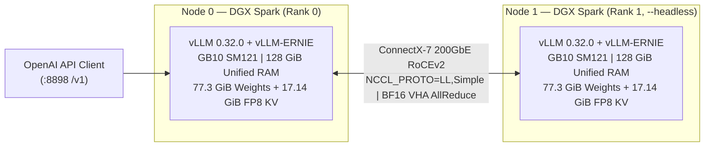

# ERNIE-5.5-Flash-Preview on 2× NVIDIA DGX Spark (`GB10 SM121`)

[](LICENSE)
[-green)](https://huggingface.co/baidu/ERNIE-5.5-Flash-Preview)
[-76b900)](docs/ARCHITECTURE_AND_PATCHES.md)
[](Dockerfile)

**[English](README.md) | [简体中文 (Chinese Guide)](README_CN.md) | [Architecture & Patches](docs/ARCHITECTURE_AND_PATCHES.md) | [Troubleshooting](docs/TROUBLESHOOTING.md) | [Changelog](CHANGELOG.md)**

Turnkey, **100% reproducible** Docker build, `SM121` kernel adaptation suite, RoCEv2 `TP=2` launcher, and benchmark harness for running **[`baidu/ERNIE-5.5-Flash-Preview`](https://huggingface.co/baidu/ERNIE-5.5-Flash-Preview)** (`280B` total / `14B` active parameters, W4A8 MXFP4 MoE, FP8 HCA + MLA-DSA sparse attention, `FlashIndexer`, and 3-layer `DSpark` speculative decoding) across **two NVIDIA DGX Spark (`Grace-Blackwell GB10`, `2 × 128 GiB` unified LPDDR5X)** nodes over **200GbE ConnectX-7 RoCEv2**.

---

## Why This Repository Exists

Upstream `vLLM 0.32.0` + `baidu/vLLM-ERNIE` targets data-center Hopper/Blackwell (`SM90`/`SM100` `FlashMLA`) and cannot boot `ERNIE-5.5-Flash-Preview` on NVIDIA DGX Spark (`DeviceCapability(12, 1)` / `SM121`, `128 GiB` shared CPU/GPU LPDDR5X) without hitting six hard blockers:

1. **`FlashMLA` incompatibility on `SM121`**: `--kv-cache-dtype fp8` hardcodes `SM90`/`SM100` `FlashMLA` backends for all `40` HCA and `6` MLA-DSA layers.
2. **Missing `SM121` `DeepGEMM` headers**: `DeepGEMM` JIT includes `sm121_*.cuh`, while upstream ships only `sm120_*.cuh`.
3. **`FlashIndexer` `8`-head assertion on Blackwell**: `SM120`/`SM121` `fp8_mqa_logits` requires `num_heads ∈ {16, 32, 64}`, whereas `FlashIndexer` gathers `8` top-k heads.
4. **`b12x` W4A8 MXFP4 `SiTU` MoE bug & missing `TinyDecode`**: `MoEDynamicKernelSitu.__init__` drops `*args, **kwargs`, and `MoETinyDecodeKernelBackend` rejects `"situ"`.
5. **Unified-memory OOM during shard loading**: Streaming `77.3 GiB/node` of safetensors balloons Linux OS page cache inside the shared `128 GiB` LPDDR5X pool.
6. **RoCEv2 + `DSpark` speculative overhead**: `fp32` VHA `AllReduce` payloads, `TP=1`-locked `GatedDeepGemmLinear`, PCIe `LL128` stalls, and `1.44 GB/step` of dense BF16 `DSparkMarkovHead` memory reads bottleneck decode and evict long-context KV caches.

This repository solves **all six** cleanly at Docker build & launch time via [`patches/patch_gb10_ernie55.py`](patches/patch_gb10_ernie55.py) and [`scripts/launch_cluster.py`](scripts/launch_cluster.py) — **zero manual file editing, zero loss in mathematical/model accuracy (`4/4` quality gate passed)**.

---

## Verified Benchmark Results (`2× DGX Spark`, `TP=2` RoCEv2, `131K` Max Context)

Measured with [`benchmarks/run_benchmark.py`](benchmarks/run_benchmark.py) (raw JSON reports in [`benchmarks/results/`](benchmarks/results/)):

| Metric / Workload | `v0.1.0` (Initial GB10 Port) | `v0.3.0` (Optimized Release) | Gain |
| :--- | :---: | :---: | :---: |
| **FP8 KV Cache Capacity (per node)** | `13.85 GiB` (`util=0.84`) | **`17.14 GiB`** (`util=0.86`) | **`+23.8%`** (`~6.5 GiB` free RAM headroom) |
| **Warm `28K` Prefix-Cache Hit TTFT** | `16,506.2 ms` (`1,690.9 tok/s`, evicted) | **`501.6 ms` (`55,625.5 tok/s`)** | **`32.9×` faster TTFT** |
| **Cold `7K` Prompt Prefill** | `1,714.9 tok/s` (`4.08 s`) | **`2,013.6 tok/s` (`3.47 s`)** | **`+17.4%`** |
| **Cold `28K` Prompt Prefill** | `1,680.9 tok/s` (`16.60 s`) | **`1,976.0 tok/s` (`14.12 s`)** | **`+17.6%`** |
| **Single-Stream Decode (`C=1`, Greedy `T=0.0`)** | `60.33 tok/s` (`5.16 tok/step`) | **`66.75 tok/s` (`5.54 tok/step`)** | **`+10.6%`** |
| **Single-Stream Math (`7^2026+11^2026 mod 100`)** | `59.17 tok/s` | **`61.30 tok/s`** | **`+3.6%`** (exact `10`) |
| **Single-Stream Chat (`C=1`, Sampled `T=0.6`)** | `27.88 tok/s` | **`29.32 tok/s`** | **`+5.2%`** |
| **Concurrent Throughput (`C=2`, Sampled `T=0.6`)** | `84.59 tok/s` | **`90.51 tok/s`** | **`+7.0%`** |
| **Concurrent Throughput (`C=4`, Sampled `T=0.6`)** | `69.67 tok/s` | **`74.86 tok/s`** | **`+7.4%`** |
| **Peak Aggregate Throughput (`C=8`, Sampled `T=0.6`)** | `103.88 tok/s` | **`118.07 tok/s`** | **`+13.7%`** |
| **Peak Aggregate Throughput (`C=8`, Greedy `T=0.0`)** | `110.39 tok/s` | **`115.16 tok/s`** | **`+4.3%`** |
| **Lossless Quality Gate** | `4 / 4` PASS | **`4 / 4` PASS** | Zero accuracy degradation |

<sub>*Benchmark provenance: `v0.1.0` figures from `benchmarks/results/r0_v010_baseline.json`; `v0.3.0` figures from consecutive full-matrix runs `r2_v030_run1.json` (single-stream & C=1/2/8 concurrency) and `r2_v030_warm_prefix.json` (C=4 sampled & cold/warm long-context prefill).*</sub>

---

## Architecture Overview



---

## Hardware & Software Prerequisites

- **2× NVIDIA DGX Spark** (`Grace-Blackwell GB10`, `ARM64` / `aarch64`, `128 GiB` unified LPDDR5X per node, `compute_cap = 12.1`)
- **200GbE ConnectX-7 RoCEv2 link** between Node 0 and Node 1 (direct QSFP/OSFP DAC cable or 200GbE switch)
- **OS & Drivers**: NVIDIA DGX OS / Ubuntu 24.04 (`aarch64`) with CUDA 13.0+ driver (`>= 580.x` / `nvidia-smi` working), Docker + `nvidia-container-toolkit`, and `rdma-core`
- **Disk Space**: `~160 GiB` free on each node for `baidu/ERNIE-5.5-Flash-Preview` weights + `~35 GiB` for Docker image & SM121 JIT cache
- **SSH**: Passwordless SSH (`ssh-copy-id`) from Node 0 to Node 1

---

## 4-Step Quickstart (Clone-and-Run on Node 0)

### Step 1 — Clone & Configure `.env`

Run on **Node 0** (your primary DGX Spark):

```bash
git clone https://github.com/Xdd-xund/ERNIE-5.5-Flash-2x-DGX-Spark.git
cd ERNIE-5.5-Flash-2x-DGX-Spark
cp .env.example .env
```

Edit `.env` to match your two nodes' 200GbE fabric IPs, SSH user, ConnectX-7 port, and desired weight directory:

```ini
NODE0_IP=10.42.0.1
NODE1_IP=10.42.0.2
NODE1_SSH=ubuntu@10.42.0.2

# Cable in Port 0 -> enp1s0f0np0 / rocep1s0f0,roceP2p1s0f0
# Cable in Port 1 -> enp1s0f1np1 / rocep1s0f1,roceP2p1s0f1
FABRIC_IFNAME=enp1s0f0np0
RDMA_HCAS=rocep1s0f0,roceP2p1s0f0
NCCL_IB_GID_INDEX=3

MODEL_DIR=/data/models/ERNIE-5.5-Flash-Preview
NODE1_MODEL_DIR=/data/models/ERNIE-5.5-Flash-Preview
```

Verify your cluster hardware, RoCEv2 GIDs, RAM headroom, and SSH before downloading/building:

```bash
./scripts/check_cluster_prereqs.sh --skip-weights
```

### Step 2 — Download & Sync Model Weights (`~154.5 GiB`)

Downloads pinned revision `ace1100dcde7bf4eb06add6ae11ce4f43a11ddfe` (`128` safetensors shards + `flashindexer/`) onto Node 0 and mirrors it across the 200GbE fabric to Node 1 via `rsync`:

```bash
# From HuggingFace Hub (supports HF_ENDPOINT mirror in .env):
./scripts/prepare_weights.sh

# Or from ModelScope (faster in Mainland China):
./scripts/prepare_weights.sh --modelscope
```

*(If you already downloaded the weights on Node 0, point `MODEL_DIR` to them in `.env` and run `./scripts/prepare_weights.sh --sync-only` if Node 1 still needs a copy, then run `./scripts/check_cluster_prereqs.sh`.)*

### Step 3 — Build the `v0.3.0` Container Image & Stream to Node 1

Builds `ernie55-dual-spark:v0.3.0` directly from official `vllm/vllm-openai:v0.32.0`, applies and byte-compile verifies all 9 `SM121` patches, and streams the built image over 200GbE SSH to Node 1:

```bash
./scripts/build_image.sh
```

### Step 4 — Launch the `TP=2` Cluster

```bash
# Preview the exact Rank 0 & Rank 1 `docker run` commands first (optional):
python3 scripts/launch_cluster.py print-cmd

# Launch Rank 1 (Node 1) + Rank 0 (Node 0) and wait for /health readiness:
python3 scripts/launch_cluster.py start --wait
```

> **Note on First-Boot JIT Compilation**: The very first cold launch compiles `SM121` FlashInfer, DeepGEMM (`nvcc`), `b12x` CuTe, and Triton kernels into `CACHE_DIR` (`~8–12 minutes`). Every subsequent restart reuses the persisted host cache and reaches `READY` in **`~75–95 seconds`**.

Common lifecycle commands:
```bash
python3 scripts/launch_cluster.py status          # Check container + /health status
python3 scripts/launch_cluster.py logs -f         # Follow Rank 0 logs (--rank 1 for Node 1)
python3 scripts/launch_cluster.py stop            # Stop containers on both nodes
```

---

## API Usage Examples (OpenAI-Compatible)

### 1. Chat & Reasoning (`enable_thinking` + `reasoning_effort`)

```bash
curl http://127.0.0.1:8898/v1/chat/completions \
  -H "Content-Type: application/json" \
  -d '{
    "model": "baidu/ERNIE-5.5-Flash-Preview",
    "messages": [
      {"role": "user", "content": "Find the remainder when 7^2026 + 11^2026 is divided by 100."}
    ],
    "temperature": 0.6,
    "max_tokens": 1024,
    "chat_template_kwargs": {"enable_thinking": true},
    "reasoning_effort": "low"
  }'
```

### 2. Fast Deterministic Coding (`enable_thinking: false`, `temperature: 0.0`)

```bash
curl http://127.0.0.1:8898/v1/chat/completions \
  -H "Content-Type: application/json" \
  -d '{
    "model": "baidu/ERNIE-5.5-Flash-Preview",
    "messages": [
      {"role": "user", "content": "Write an async token-bucket rate limiter in Python."}
    ],
    "temperature": 0.0,
    "max_tokens": 1024,
    "chat_template_kwargs": {"enable_thinking": false}
  }'
```

### 3. Reproduce the Full Benchmark & `4/4` Quality Gate

```bash
python3 benchmarks/run_benchmark.py \
  --base-url http://127.0.0.1:8898 \
  --label my_dual_spark \
  --out benchmarks/results/local_my_dual_spark.json \
  --verify-quality
```

---

## Repository Structure

```text
ERNIE-5.5-Flash-2x-DGX-Spark/
├── Dockerfile                        # Standalone build from official vllm/vllm-openai:v0.32.0
├── .env.example                      # Cluster IP / ConnectX-7 / path / engine configuration template
├── patches/
│   └── patch_gb10_ernie55.py         # Idempotent, anchor-asserted 9-patch SM121 adaptation & speed suite
├── scripts/
│   ├── check_cluster_prereqs.sh      # Pre-flight hardware, RAM, RoCEv2 GID, SSH, Docker & shard checker
│   ├── prepare_weights.sh            # HuggingFace / ModelScope downloader + 200GbE rsync to Node 1
│   ├── build_image.sh                # Docker builder + zstd/gzip 200GbE image streamer to Node 1
│   ├── launch_cluster.py             # Turnkey TP=2 cluster manager (start/stop/status/logs/health/print-cmd)
│   └── verify_release_hygiene.py     # Automated PII/secret/link/syntax verifier
├── benchmarks/
│   ├── run_benchmark.py              # Streaming throughput, prefill, & 4-check lossless quality harness
│   └── results/                      # Committed v0.1.0 baseline vs. v0.3.0 optimized JSON reports
├── docs/
│   ├── ARCHITECTURE_AND_PATCHES.md   # Deep-dive into all 9 SM121 patches, RoCEv2 tuning, & negative results
│   └── TROUBLESHOOTING.md            # ConnectX-7 Port 0/1 mapping, GID index, unified-RAM OOM, JIT warmup
└── tests/
    └── test_repo_integrity.py        # Automated unit & integrity test suite
```

---

## License & Acknowledgements

- **Repository Code & Patches**: Licensed under the **[Apache License 2.0](LICENSE)**.
- **Upstream Projects**: Built on top of [Baidu `ERNIE-5.5-Flash-Preview`](https://huggingface.co/baidu/ERNIE-5.5-Flash-Preview) & [`baidu/vLLM-ERNIE`](https://github.com/baidu/vLLM-ERNIE), [`vLLM`](https://github.com/vllm-project/vllm), [`b12x`](https://pypi.org/project/b12x/), [`FlashInfer`](https://github.com/flashinfer-ai/flashinfer), and [`DeepGEMM`](https://github.com/deepseek-ai/DeepGEMM). See [`THIRD-PARTY-NOTICES.md`](THIRD-PARTY-NOTICES.md) for complete attributions.
